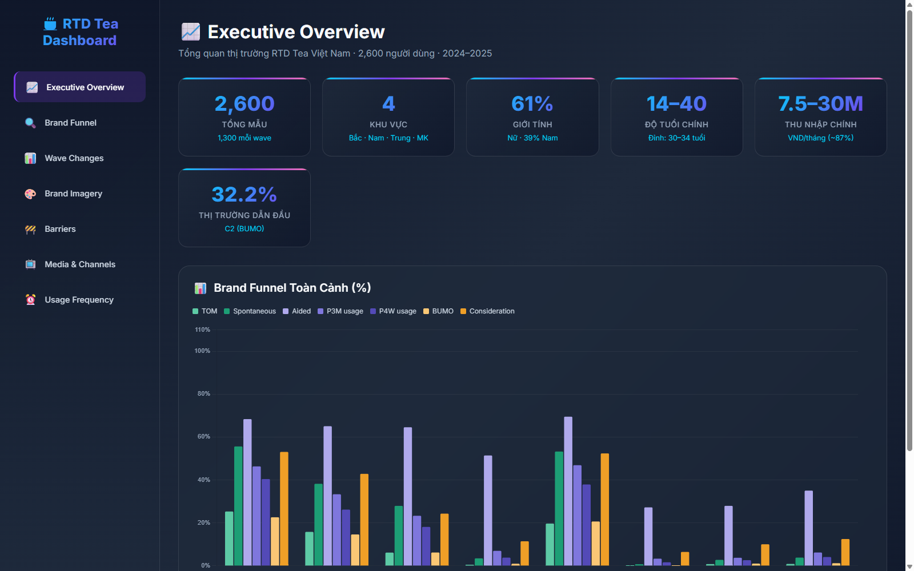
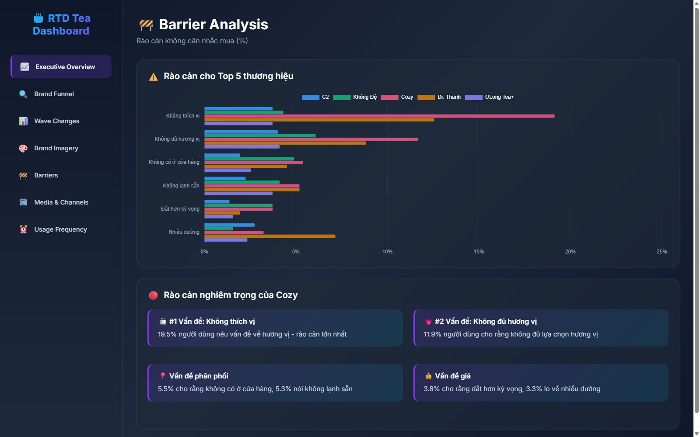

# 🍵 Ready-To-Drink (RTD) Tea Brand Health Analysis & Strategic Growth Framework

[](https://github.com/trancamtu3518)
[](https://trancamtu3518.github.io/RTD-Tea-Brand-Health-Analysis/)
[](Report_Brand_Health_RTD_Tea_Market.pdf)
[](https://www.python.org/)

> **Project Origin:** Originally developed as a competing solution that achieved **Top 20 Finalist at the MyInsight Data Analytics Competition**, this repository represents an end-to-end **remade, enriched, and production-ready analytics framework** focusing on Data Storytelling, Statistical Rigor, and Actionable Business Strategy.

---

## 📌 Executive Summary & Key Business Insights

Evaluating a comprehensive dataset of **2,600+ Vietnamese consumers**, this project diagnoses brand health metrics (TOM, Spontaneous Awareness, Consideration, Trial, Regular Usage) across major players in the Ready-To-Drink (RTD) Tea industry (*C2, OLong Tea+, Cozy, Dr.Thanh, etc.*).

### 🔍 Critical Findings:
* **Polarized Duopoly:** The market exhibits a heavy *"winner-takes-most"* dynamic dominated by C2 and OLong Tea+, capturing over 65% of the consideration set.
* **The 19.5% Conversion Bottleneck:** Funnel & barrier analysis revealed that for a key challenger brand, the drop-off from *Trial to Regular Consumption* was primarily driven by **taste dissatisfaction (19.5%)**—nearly **5x higher** than industry competitors.
* **Strategic Takeaway:** The core growth inhibitor was **product experience & flavor formulation**, not brand awareness or marketing reach.

---

## 📊 Dashboard & Visual Showcase

> Interactive dashboard preview showcasing core brand health metrics, funnel diagnosis, and barrier analysis:

| Executive Overview & Brand Funnel | Barrier & Conversion Bottleneck Analysis |
| :---: | :---: |
|  |  |

👉 **[Launch Interactive Live Dashboard](https://trancamtu3518.github.io/RTD-Tea-Brand-Health-Analysis/)**

---

## 💡 Proposed 3-Phase Strategic Action Plan

1. **Phase 1 – Core Product Optimization (Months 1–3):** Reformulate flavor profile and reduce sweetness variance based on consumer sensory feedback; resolve the 19.5% trial barrier.
2. **Phase 2 – Channel Expansion (Months 4–8):** Penetrate modern on-premise channels (HoReCa, universities, convenience store combos) to intercept high-frequency trial occasions.
3. **Phase 3 – Healthy-Living Repositioning (Months 9–12):** Capitalize on zero-sugar / low-calorie trends to establish a distinctive positioning against traditional RTD competitors.

---

## 📁 Repository Structure

```text
├── assets/                                   # Dashboard visual showcases and preview screenshots
├── Statistical_Testing_RTD_Tea_Market.ipynb  # Core ETL, Data Cleaning & Statistical Hypothesis Testing
├── RTD_Tea_Brand_Health_Dashboard.html       # Standalone interactive dashboard (HTML5, CSS3, Chart.js)
├── index.html                                # GitHub Pages live demo entrypoint
├── Report_Brand_Health_RTD_Tea_Market.pdf    # Executive presentation slide deck (In-browser readable PDF)
├── Report_Brand_Health_RTD_Tea_Market.pptx   # Executive presentation slide deck (PowerPoint source)
├── data/                                     # Survey dataset & processed tabular data
└── README.md                                 # Documentation & Project Overview
```

---

## 🛠️ Technical Stack & Methodologies

* **Data Processing & Analytics:** Python (`pandas`, `numpy`, `scipy.stats`)
* **Statistical Testing:** Chi-square Test of Independence, ANOVA, Proportion Z-Test
* **Front-End Visualization:** Standalone `HTML5`, `CSS3`, `Chart.js` for interactive UI/UX
* **Business Frameworks:** Brand Health Funnel (Awareness > Consideration > Trial > Loyalty), Barrier Analysis, Market Penetration Index

---

## 🚀 How to Experience This Project

1. **Interactive Dashboard (Live Web Demo):** Click **[Live GitHub Pages Demo](https://trancamtu3518.github.io/RTD-Tea-Brand-Health-Analysis/)** to explore and interact with the visualizations directly in your browser without installing anything.
2. **Executive Slide Deck (PDF):** View the complete presentation directly on GitHub via **[Report_Brand_Health_RTD_Tea_Market.pdf](Report_Brand_Health_RTD_Tea_Market.pdf)** (or download the raw `.pptx` version).
3. **Code & Statistical Analysis:** Inspect **[Statistical_Testing_RTD_Tea_Market.ipynb](Statistical_Testing_RTD_Tea_Market.ipynb)** via GitHub preview or Jupyter/Google Colab to examine clean hypothesis testing, data transformations, and business findings.

---

## 👩‍💻 Author

**Tran Cam Tu**  
*Final-Year Data Science Student @ Ho Chi Minh City University of Industry and Trade (HUIT)*  
* Career Focus: **Data Analyst / Business Analyst**  
* ✉️ Email: trancamtu3518@gmail.com  
* 🔗 LinkedIn: [linkedin.com/in/trancamtu3518](https://linkedin.com)  
* 📂 GitHub: [github.com/trancamtu3518](https://github.com/trancamtu3518)
